# Схема workflow проекта

Канон — `.agents/rules/workflow_scheme.md`; это зеркало для Claude Code.
Правка канона делается в каноне и зеркалится сюда.

Сквозной процесс: агенты, документация, гейты с участием владельца, коммиты/пуши, деплой
(если ведётся). Канон правил: `product_docs.md`, `tasktracker.md`, `ui_workflow.md`,
`dev_team.md` (этот каталог), «Живая документация продукта» в корневом `AGENTS.md`,
`product_docs/README.md`; деплой и CI — по настройкам проекта (`infra/`, CI-конфиг).

```mermaid
flowchart TD
    subgraph ANALYSIS["1. Аналитика — агент analyst (фазы BABOK: python phase.py)"]
        A1["input/: интервью, модели, скрины"] --> A2["Главы 3-6: планирование, выявление, стратегия. Слой 1: output/reports/<project_id>/"]
        A2 --> A3["Глава 7.1: спеки FR / UC / NFR / BR в output/data/<project_id>/specs/ + граф 5.1 (draft)"]
        A3 --> A4["Глава 5.4: дельта вне baseline - Change Request CR-NNN"]
        A4 --> G1{"ГЕЙТ 1 - владелец: решение по CR"}
        G1 -->|"approved"| A5["Глава 5.5: пакет утверждения (baseline; при новой функции - новая версия)"]
        A5 --> G2{"ГЕЙТ 2 - владелец: приёмка пакета 5.5"}
    end

    G2 -->|"шаг «синхронизировать product_docs»"| SYNC["Sync слоя 2 (только аналитик): карточка BF-NN в planned с разделом «Планируемое изменение», страница компонента, INDEX.md, check_product_docs.py без ошибок"]

    SYNC --> TRACK[("Трекер: эпик BF-NN + подзадачи; запись «аналитика по BF-NN завершена»")]
    TRACK --> GATE{"ВОРОТА Arch/Dev/QA: карточка planned + 5.5 approved + задача в трекере"}
    GATE -->|"не пройдены: вернуть аналитику"| GATEBACK["архитектор называет причину, задача возвращается аналитику"]
    GATE -->|"пройдены"| ARCH["2. Агент arch: декомпозиция на задачи, ADR, целевые страницы planned, блок «Архитектурное решение»"]

    ARCH --> UXPH["3. Агент ux: 2-3 варианта экрана, design/<задача>/"]
    UXPH --> G3{"ГЕЙТ 3 - владелец: апрув decision.md"}
    G3 -->|"approved"| TASKS["Dev/QA-задачи в трекере (ссылки на BF-NN, FR-ID, страницы компонентов)"]

    subgraph DEVPH["4. Разработка — агент dev"]
        TASKS --> D1["Backlog - ворота проверены - взял: In Progress (трекер)"]
        D1 --> D2["ветка задачи; коммит с типом и номером задачи; push"]
        D2 --> CG{"CI проекта: lint_test + secrets (+ db-isolation, если ведётся)"}
        CG -->|"green"| D3["Локальный QA-гейт: линтеры + тесты; audit секретов; проверки по настройкам проекта"]
    end

    D3 --> IR[("In Review: описание задачи обновлено - что сделано / что осталось")]
    IR --> QA["5. Агент qa: приёмка против decision.md и спеки; контрольный пример из FR; проверки по решению (темы/ширины/план); отчёт в qa/"]
    QA --> G4{"Pass?"}
    G4 -->|"замечания"| BUG["Баг-задача на dev: In Progress, новый коммит в ветку"]
    BUG --> D2
    G4 -->|"Pass"| FACT["6. Аналитик приводит страницы к факту: BF-NN в implemented, страница компонента обновлена, check_product_docs.py = 0"]

    FACT --> DONE[("Done в трекере (без апрува владельца не переносить)")]
    DONE --> DEP["7. devops / владелец: merge в main + push"]
    subgraph DEPLOY["8. Деплой — по настройкам проекта (если ведётся)"]
        DEP --> SH["deploy-скрипт проекта: локальные проверки -> сборка пакета -> доставка на целевую машину\n миграции при изменении схемы (с предшествующим дампом БД),\n build/up, ожидание /health, автооткат при сбое"]
        SH -->|"красно"| RB["Авто-откат на предыдущую версию, владелец уведомлён"]
        SH -->|"зелено"| LIVE["DEPLOYED_VERSION, адрес продукта"]
    end

    LIVE --> G5{"ГЕЙТ 4 - владелец: приёмка в браузере - вход, бизнес-функции по скоупу релиза; учётные данные вводит сам, агент их не использует"}
    G5 -->|"принято"| EPILOG["Функция в работе; дельта замечаний - через CR 5.4 / задачу"]
```

## Гейты с участием владельца

| № | Гейт | Готовит | Артефакт решения |
|---|---|---|---|
| 1 | Решение по CR (5.4) — весь скоуп/срок | analyst | `output/reports/<project_id>/5_4_cr_decision_CR-NNN_*` (Approved) |
| 2 | Приёмка пакета утверждения (5.5) | analyst | `5_5_approval_package_APKG-*_*.md` |
| 3 | Апрув дизайна UI | ux | `design/<задача>/decision.md` → `approved` |
| 4 | Приёмка после деплоя (браузер: вход, бизнес-функции) | devops делает deploy, проверяет владелец | комментарий в задаче/чате |
| — | Особые: OpenSpec — только по подтверждению; смена меток/приоритета; удаление данных (депрекация вместо удаления); учётные данные — только сам владелец | — | — |

Приёмка задач без QA-агента (мелкие правки) — Done по факту приёмки владельцем.

### Что создаётся на Гейте 2 (разграничение)

На **Гейте 2** (пакет 5.5 принят) создаются только: **BF-карточка** (`planned`, раздел
«Планируемое изменение»), **эпик в трекере** («BF-NN: <название>» — подзадачи всех ролей)
и **baseline 5.5**. Целевые страницы **системных компонентов** (`02_system_components/`)
и **архитектуры** (`architecture/`, декомпозиция, ADR) создаются на этапе **Arch — после
Гейта 2** (по сигналу «аналитика по BF-NN завершена»), не вместе с Гейтом 2.

## Плоскости документации и «один писатель»

| Плоскость | Папка | Кто пишет | Контроль |
|---|---|---|---|
| Журнал и требования (слой 1) | `output/` — data (MCP, JSON + specs), reports (события) | analyst (MCP глав BABOK) | граф 5.1 |
| Бизнес-функции | `product_docs/01_business_functions/BF-NN_*/README.md` | analyst | `python product_docs/check_product_docs.py` (ошибки = код 1) |
| Системные компоненты | `product_docs/02_system_components/` (SRV / API / SEQ / MAP / ERD / FLV) | analyst («как есть»); блок «Архитектурное решение» — arch | там же |
| Архитектура | `architecture/` (C4, ADR, NFR-матрица, развёртывание) | arch | ADR-номера |
| Дизайн UI | `design/<задача>/` (brief, варианты, decision.md, PNG) | ux | ворота Dev = `approved` |
| Код продукта | каталоги кода проекта (backend, frontend, миграции) | dev | CI проекта |
| Тесты и приёмка | `qa/`, тестовые каталоги продукта | qa (+ dev unit) | отчёты `qa/` |
| Инфраструктура | `compose*`, `infra/`, `scripts/`, CI | devops | отчёты `infra/` |

Dev/QA/DevOps карточки БФ и страницы компонентов **не правят** — изменение поведения
описывается комментарием к задаче; аналитик приводит страницы к факту (5.2 / CR 5.4).

## Движение задачи и эпиков в трекере (YouGile — пример; механика переносима)

**Эпик = бизнес-функция:** на Гейте 2 создаётся эпик «BF-NN» — все задачи функции
(BA, Arch, UX, Dev, QA, задачи СА/интеграций) — его подзадачи; без БФ — эпик
«Инфраструктура/ops». До Гейта 2 аналитика идёт в эпиках аналитики. Эпик → `In Progress`
со старта первой подзадачи, `Done` — когда все подзадачи закрыты (открытые CR не дают
закрыть эпик; после Done CR идёт эпиком «BF-NN (CR-NNN)» / «BF-NN v2»). Связь задач
с BF-карточкой обновляет аналитик (Arch правит только трекер). Детали — `tasktracker.md`.

`Backlog` → (взял задачу) `In Progress` → (код готов + локальный гейт + описание updated)
`In Review` → (QA Pass + слой 2 синхронизирован) `Done`.
Ограничения: ≤ 1 задача в In Progress на агента; ≤ 5 в In Review; Done — только после QA Pass
или приёмки владельцем (детали — `tasktracker.md`).

## Полные правила

- слой 2 и плоскости: `.claude/rules/product_docs.md`, `product_docs/README.md`;
- колонки трекера: `tasktracker.md`; UI-ворота Dev: `ui_workflow.md`;
- роли команды разработки: `dev_team.md`;
- фазы BABOK (какой набор MCP активен): `python phase.py` — после смены фазы перезапуск сессии.
